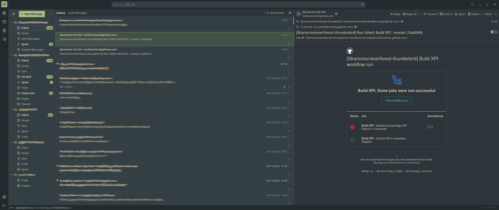

# 🌲 Everforest Medium Dark theme for Thunderbird

> [!CAUTION]
> **You NEED to set `toolkit.legacyUserProfileCustomizations.stylesheets` to `true` in Thunderbird config editor!!!**

### Guide
1. Download the .xpi [file](https://github.com/Skartorion/everforest-thunderbird/blob/master/everforest-dark-medium.xpi)
2. Navigate to three-lines menu -> Add-ons and Themes -> click on a cogwheel -> Install Add-on From File... -> select the .xpi file you've downloaded
3. Open settings -> General -> scroll down, press on Advanced settings -> in the preference bar search for `toolkit.legacyUserProfileCustomizations.stylesheets` -> set it to `true` (yes this is mandatory it will look weird otherwise)
4. Restart Thunderbird
5. Star the repo if you liked the theme

### Example

Everforest Dark Medium for Thunderbird. Colours by [sainnhe](https://github.com/sainnhe/everforest). Based on [jarith’s](https://github.com/jarith/everforest-night-thunderbird) Everforest Night theme

### Issues
So, um, if there's any issues then make an issue!
